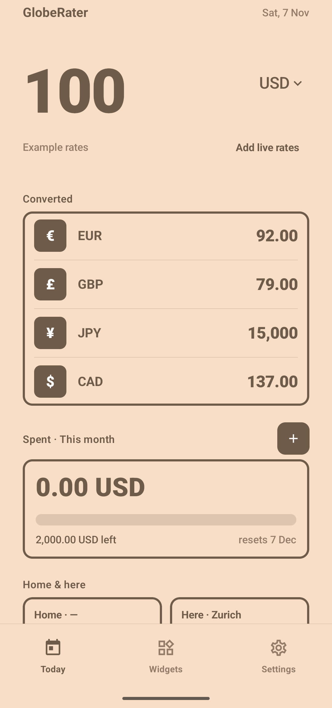
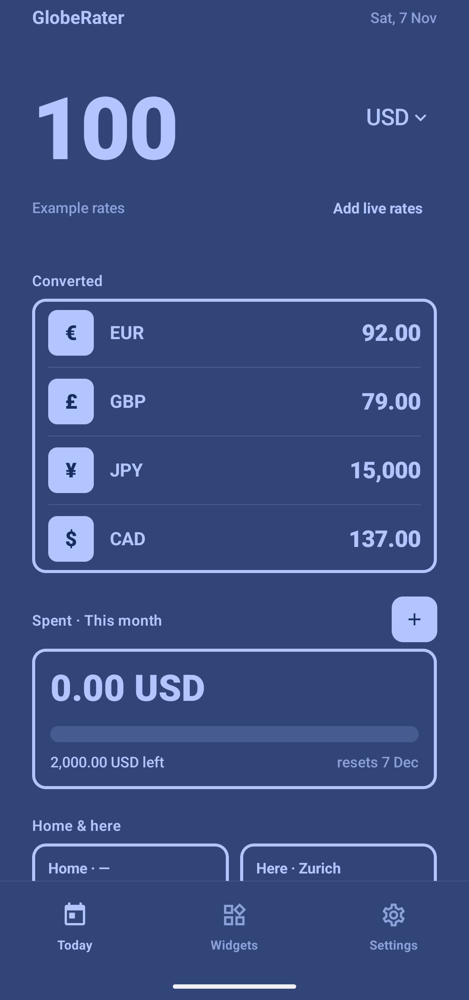

<p align="center">
  
</p>

<h1 align="center">GlobeRater</h1>

<p align="center">
  Home-screen widgets for travellers: convert currencies, track a holiday budget,<br>
  and keep an eye on the time and weather back home.
</p>

<p align="center">
  <a href="../../releases/latest"><b>Download the APK</b></a> ·
  Android 8.0+ · 15 languages · MIT
</p>

<p align="center">
  
  &nbsp;&nbsp;
  
</p>

## What it does

**Currency widgets.** A keypad right on the home screen: type an amount and see it in up to five currencies at once. Rates come from [Open Exchange Rates](https://openexchangerates.org/signup/free) (a free key is enough) and are stored on the phone, so the widgets keep working offline.

**Budget widgets.** Set a budget per day, week, month or year. Every converter with a budget has a **+** key that adds what you just typed. The bar, or the whole background on the compact widget, fills up as you spend, and starts over at the beginning of each period.

**Travel widgets.** Your home time next to the local time, and the weather in both places (now, today, tomorrow). "Here" can be a fixed city or wherever your phone is.

**Colours.** Each widget can use one of seven palettes or follow your wallpaper colours (Material You, Android 12+). Tap the empty part of a widget to change it.

## Widgets

| Converter | Budget | Travel |
|---|---|---|
| Compact · Tall · Compact + budget · Tall + budget | Vertical · Horizontal · Mini | Clock · Weather |

## Light on the battery

- Widgets only read data saved on the phone; nothing runs while you don't use them.
- Rates refresh in the background once per chosen interval (daily by default) through WorkManager, when the phone has a connection.
- Weather refreshes every 3 hours, and only if you have set places.
- The clock widget uses `TextClock`, which keeps time by itself.
- Location (optional) is approximate and only read while the app is open. There is no background location.

## Languages

English, French, Spanish, Portuguese, German, Italian, Dutch, Russian, Turkish, Arabic, Hindi, Chinese (simplified), Japanese, Korean and Indonesian. The app follows the phone's language, and on Android 13+ you can pick another one in *Settings → Apps → GlobeRater → Language*.

## Build

Requirements: Android Studio (or JDK 17) and the Android SDK 36.

```bash
./gradlew assembleDebug
```

Release builds are minified with R8. To sign them, copy `keystore.properties.example` to `keystore.properties` and point it to your keystore.

```bash
./gradlew assembleRelease bundleRelease
```

The widget palettes and the translations are generated:

```bash
python3 tools/gen_palettes.py
python3 tools/gen_strings.py
```

## Privacy

GlobeRater has no account, no analytics and no ads. It only talks to:

- **openexchangerates.org**, with your own API key, to download exchange rates;
- **open-meteo.com**, with the coordinates of the places you chose, to get the weather.

Everything else stays on your phone.

## Credits

- Exchange rates: [Open Exchange Rates](https://openexchangerates.org)
- Weather and geocoding: [Open-Meteo](https://open-meteo.com) (CC BY 4.0)
- Weather icons drawn after [Feather](https://feathericons.com) (MIT)

## License

[MIT](LICENSE) © 2026 Tageoa
